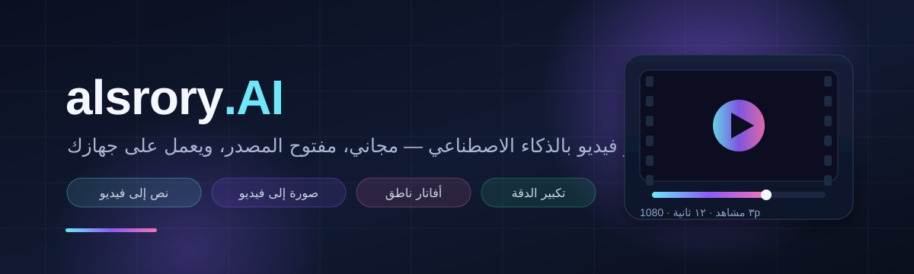

# alsrory.AI

> استوديو فيديو بالذكاء الاصطناعي — مفتوح المصدر، مجاني، ويعمل على جهازك.

**alsrory.AI** تطبيق ويب محلي (Local-first) لتوليد الفيديو بالذكاء الاصطناعي: نص إلى فيديو، صورة إلى فيديو، تحرير فيديو، أفاتار ناطق، تعليق صوتي وموسيقى، تكبير الدقة، ومونتاج كامل — كل ذلك بواجهة عربية (RTL) ومحرّك نماذج مفتوحة قابل للتبديل.

<p align="center">
  
</p>

---

<div dir="rtl" align="right">

## لماذا alsrory.AI؟

| المبدأ | التطبيق |
|---|---|
| **مجاني بالكامل** | لا اشتراكات ولا حصص. النماذج مفتوحة المصدر وتعمل على عتادك أو على GPU مجاني. |
| **مفتوح المصدر** | الكود كله متاح تحت رخصة AGPL-3.0. لا صناديق سوداء. |
| **خصوصية** | مشاريعك وفيديوهاتك تبقى على جهازك. لا تُرسل لأي خدمة إلا إذا اخترت أنت ذلك. |
| **قابل للتبديل** | محرّك واحد لواجهة واحدة، ومنفّذون متعددون: ComfyUI محلي، Colab/Kaggle، Hugging Face Spaces، أو محرّك تجريبي. |
| **عربي أولاً** | واجهة RTL كاملة، أوامر عربية، تعليق صوتي عربي، وترجمة تلقائية. |

## الميزات

- 🎬 **نص → فيديو** — وصف عربي أو إنجليزي، نسب عرض، مدة، حركة كاميرا، بذرة عشوائية، دفعات متعددة.
- 🖼️ **صورة → فيديو** — تحريك صورة ثابتة مع التحكم بشدة الحركة وإطار النهاية.
- 🎞️ **فيديو → فيديو** — إعادة تلوين، تمديد، استبدال عناصر بقناع (Inpainting).
- 🗣️ **أفاتار ونطق الشفاه** — نص → صوت → مزامنة شفاه مع صورة أو فيديو شخصية.
- 🎙️ **صوت** — تعليق صوتي (TTS)، موسيقى خلفية، مؤثرات، خفض تلقائي للموسيقى تحت الكلام.
- ✨ **تكبير وإصلاح** — حتى 4K، ترميم الوجوه، زيادة الإطارات (60fps).
- ✂️ **مونتاج احترافي** — تايم لاين، قص، انتقالات، ترجمة مدمجة، تصدير لمنصات التواصل.
- 📚 **مكتبة ومشاريع** — مشاهد، نسخ، إعادة استخدام البذور والإعدادات، سجل كامل.
- 🧠 **مساعد الإخراج** — تحويل فكرة إلى قائمة مشاهد (Shot List) عبر LLM محلي.

## البدء السريع

```powershell
# 1) تثبيت الأدوات المحمولة (Node + Python venv) — مرة واحدة
.\scripts\setup.ps1

# 2) تشغيل التطبيق
.\scripts\run.ps1
```

أو بالنقر المزدوج على Windows: `scripts\setup.bat` ثم `scripts\run.bat`
(و`scripts\stop.bat` للإيقاف).

ثم افتح: **http://localhost:3000**

> التشغيل الأول يستخدم **المحرّك التجريبي** (Mock) لتجربة الواجهة كاملة بدون GPU.
> لتوليد فيديو حقيقي، راجع [`docs/04-hardware-and-free-gpu.ar.md`](docs/04-hardware-and-free-gpu.ar.md).

### الحالة الحالية

| الجزء | الحالة |
|---|---|
| الواجهة العربية (لوحة، استوديو، مكتبة، مونتاج، إعدادات) | ✅ يعمل |
| المشاريع + قاعدة البيانات + رفع الوسائط | ✅ يعمل |
| التوليد بالمحرّك التجريبي (فيديو MP4 حقيقي بـ FFmpeg) | ✅ يعمل بدون GPU |
| التصدير من التايم لاين (دمج + H.264) | ✅ يعمل |
| محرّك ComfyUI محلي أو عبر Colab/Kaggle | ✅ جاهز للربط — يحتاج GPU |
| أفاتار/نطق شفاه، تكبير، TTS | 🔜 عقود المحرّك جاهزة، الـ workflows تُضاف لاحقاً |

> على الأجهزة بدون GPU: استخدم المحرّك التجريبي لتجربة كل شيء، أو شغّل دفتر
> [`workers/colab/alsrory_engine.ipynb`](workers/colab/alsrory_engine.ipynb) على Colab/Kaggle
> والصق الرابط في الإعدادات.

## المتطلبات

| السيناريو | العتاد |
|---|---|
| تجربة الواجهة فقط | أي جهاز (المحرّك التجريبي) |
| توليد محلي | NVIDIA بـ 8GB VRAM كحد أدنى (المفضّل 16GB+)، 32GB RAM، 100GB مساحة |
| توليد مجاني | حساب Google Colab أو Kaggle (GPU مجاني بحدود استخدام) |

## بنية المشروع

```
alsrory-ai/
├─ apps/web/            # واجهة Next.js 15 (عربي RTL)
├─ services/api/        # خادم FastAPI + قاعدة SQLite + طابور المهام
├─ workers/
│  ├─ comfy/            # قوالب ComfyUI API workflows + دليل الربط
│  └─ colab/            # دفتر Colab/Kaggle + وسيط الحماية بالرمز
├─ docs/                # الرؤية، المعمارية، الميزات، خارطة الطريق
├─ scripts/             # التثبيت والتشغيل (PowerShell + .bat)
└─ data/                # مشاريعك وملفاتك (غير مرفوعة إلى Git)
```

## الوثائق

| الملف | المحتوى |
|---|---|
| [docs/01-vision.ar.md](docs/01-vision.ar.md) | الرؤية والجمهور والمبادئ |
| [docs/02-architecture.ar.md](docs/02-architecture.ar.md) | المعمارية وتدفّق الطلب والعقود |
| [docs/03-features.ar.md](docs/03-features.ar.md) | مصفوفة الميزات والنماذج المفتوحة لكل منها |
| [docs/04-hardware-and-free-gpu.ar.md](docs/04-hardware-and-free-gpu.ar.md) | العتاد وخيارات GPU المجاني خطوة بخطوة |
| [docs/05-roadmap.ar.md](docs/05-roadmap.ar.md) | المراحل ومعايير القبول |
| [docs/06-setup.ar.md](docs/06-setup.ar.md) | التثبيت والتشغيل وحل المشاكل |
| [docs/07-decisions.ar.md](docs/07-decisions.ar.md) | قرارات معمارية (ADR) |
| [workers/comfy/README.md](workers/comfy/README.md) | ربط ComfyUI وقوالب الـ workflows |
| [workers/colab/alsrory_engine.ipynb](workers/colab/alsrory_engine.ipynb) | دفتر Colab/Kaggle لتشغيل محرّك مجاني |

## الرخصة

AGPL-3.0 — استخدم، عدّل، وشارك بحرية. إذا قدّمت الخدمة للعامة عبر الشبكة، يجب نشر تعديلاتك.
النص الكامل في [`LICENSE`](LICENSE).

</div>
